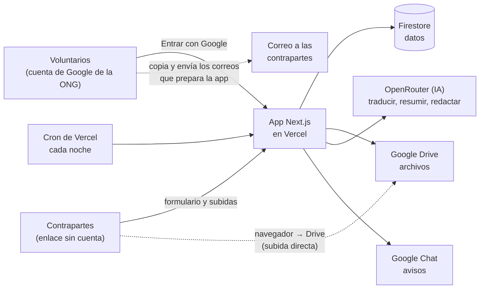
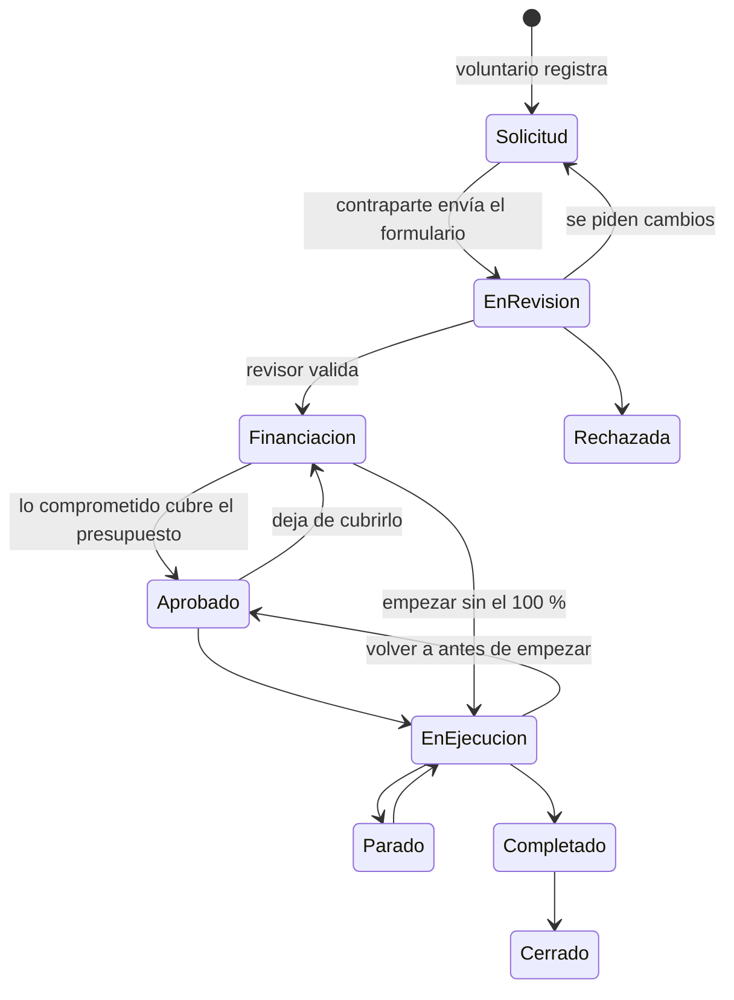
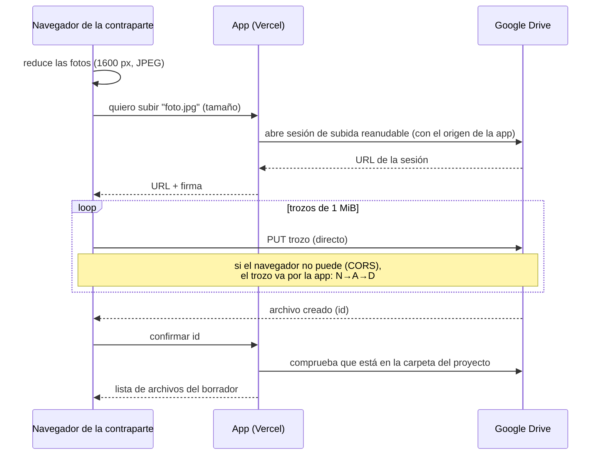

# Cómo funciona el sistema

## En una frase

Una aplicación web propia (Next.js en Vercel) organiza el trabajo y guarda los datos en Firestore. Google Drive guarda los archivos, Google Chat avisa a los voluntarios, y la IA de OpenAI traduce, resume y, más adelante, redacta borradores. Los voluntarios solo deciden y revisan.

## Piezas



| Pieza | Qué hace | Coste | Límites que importan |
| --- | --- | --- | --- |
| **App Next.js** (Vercel Hobby) | Pantallas, API y todas las reglas. Es la única pieza con lógica propia, escrita en TypeScript | Gratis | 4,5 MB por petición, 300 s por función, cron una vez al día |
| **Firestore** (Firebase Spark) | Base de datos, en Europa. Solo la usa el servidor | Gratis | 50.000 lecturas y 20.000 escrituras al día |
| **Firebase Auth** | Entrar con Google; solo cuentas `@africadirecto.org` | Gratis | — |
| **Google Drive** (unidades compartidas) | Archivos de cada proyecto, plantillas y copias | Gratis (100 TB) | — |
| **Google Chat** (webhook) | Avisos a los voluntarios | Gratis | — |
| **OpenRouter** (IA) | Traducir, resumir, señalar lo que falta y redactar borradores de informe. Da acceso a modelos de varios proveedores con una sola clave | ~1 $/mes | El saldo cargado y el límite de la clave |

El servidor casero de la ONG **no forma parte del sistema**; como mucho, puede descargar una segunda copia de las copias nocturnas.

## El recorrido de un proyecto



*Cancelado es posible desde cualquier estado no final. Cada cambio guarda quién, cuándo y por qué en la cronología.*

- **Antes de empezar, Financiación y Aprobado los pone la app según el dinero**, en los dos sentidos: Aprobado cuando lo comprometido cubre el presupuesto en euros, y de vuelta a Financiación si deja de cubrirlo (se quita un compromiso o sube el presupuesto). A mano solo se elige uno de los dos al volver desde En ejecución (si la ejecución no había empezado de verdad; se borra la fecha de inicio), y la app pone el que corresponde al dinero.
- **Se puede empezar sin el 100 %:** de Financiación a En ejecución, con un aviso en el diálogo.
- **Deshacer:** el último cambio hecho a mano en la ficha se puede deshacer, también Cancelado y Cerrado. El proyecto vuelve al estado anterior con el formulario de la contraparte y las fechas (inicio, aprobación, cierre) como estaban; si el anterior era Financiación o Aprobado, al que diga el dinero ahora. Para eso el proyecto guarda `ultimoCambio` (de, a, origen, autor y lo que había antes). Los cambios automáticos no se deshacen (se corrige el dato que los causó) y deshacer no se deshace. La última decisión de revisión se deshace con su propia regla (punto 4), desde la ficha o desde Solicitudes.
- Hasta noviembre de 2026 había un estado «Validada» entre la revisión y la financiación; los datos antiguos con ese estado se leen como Financiación (`normalizarEstado`).

Qué ocurre por dentro en cada paso:

1. **Nueva solicitud** (voluntario con permiso de edición):
   - Se crea la contraparte, si es nueva, y el proyecto con un código `P-AAAA-NNN` de un contador anual.
   - Se crea su carpeta en Drive con las 7 subcarpetas y un enlace firmado para la contraparte.
   - Si el correo está configurado, se le envía el formulario en su idioma.
2. **Formulario de la contraparte** (`/f/<token>`):
   - Se guarda a cada cambio en el móvil y, a los 2,5 s, en el servidor (borrador).
   - Las fotos se reducen en el navegador antes de subir. Los archivos van a Drive en trozos de 1 MiB, y si se corta la conexión se reanuda donde se quedó (detalle más abajo).
3. **Envío:**
   - Se guarda la versión `vN`, se copian los datos a la ficha y el proyecto pasa a «En revisión».
   - Al terminar la respuesta, y sin hacer esperar a la contraparte, la IA traduce, resume y señala lo que falta, se genera el PDF en `01_Solicitud` y se avisa en Chat.
4. **Revisión:** validar, pedir cambios o rechazar, solo desde Solicitudes.
   - La última decisión se puede corregir (el comentario, que se vuelve a traducir) o deshacer mientras el proyecto siga donde ella lo dejó: la contraparte no ha enviado otra versión y una propuesta validada aún no tiene compromisos de donantes. Deshacer borra la revisión y devuelve el proyecto a «En revisión». Validar pasa la propuesta a «Financiación» y guarda la fecha de validación.
   - Al pedir cambios, el comentario se traduce al idioma de la contraparte, el mismo enlace se reabre (y se alarga su caducidad) y la app prepara el correo para que el voluntario lo envíe. La app no envía correos.
5. **Financiación:**
   - Tres movimientos, todos en euros: **compromiso** (un donante se compromete; si ya estaba en el proyecto, se suma), **cobro** (llega a AD dinero de un donante, con fecha) y **envío** (AD transfiere a la contraparte, con fecha; va por proyecto, no por donante).
   - Límites: no se cobra de un donante más de lo que ha comprometido ni se envía más de lo cobrado en el proyecto (el formulario no deja guardar y explica por qué; el servidor lo comprueba otra vez). Tampoco se puede quitar un compromiso si lo comprometido quedaría por debajo de lo cobrado, ni un cobro si lo enviado quedaría por encima de lo cobrado. Un donante que se queda sin registros sale del proyecto.
   - En la ficha, cada donante se despliega para ver sus registros (compromisos y cobros) con fecha y nota; los envíos tienen su propia lista.
   - Cada aportación (una por donante y proyecto) guarda sus compromisos y sus cobros, cada uno con fecha y nota, y sus totales; el proyecto guarda sus envíos y los totales comprometido, `recibido` (cobrado) y `enviado`. Las aportaciones antiguas (un importe y un estado) se leen así: «comprometida» y «recibida» pasan a ser un compromiso (la recibida, también un cobro); las demás no cuentan y no se muestran.
   - Al cambiar una, se recalculan los totales. Cuando lo comprometido cubre el presupuesto el proyecto pasa solo a «Aprobado», y si deja de cubrirlo antes de empezar, vuelve solo a «Financiación».
6. **Ejecución y seguimiento:** notas, cambios de estado y, en la fase 2, correos y fotos que llegan.
   - La app avisa de los proyectos sin noticias en más de 30 días.
7. **Informes:** borradores de IA en Google Docs o Slides que un voluntario revisa en Google y descarga para enviarlos. Ver [INFORMES.md](INFORMES.md).

## Datos

Firestore guarda documentos JSON en colecciones. Las fechas se guardan como texto ISO.

| Colección | Qué guarda |
| --- | --- |
| `proyectos/{código}` | Ficha del proyecto: estado, ubicación, presupuesto y totales, carpeta de Drive, contraparte (copia), estado del formulario y fechas (inicio de obra, aprobación, cierre…) |
| └ `solicitudes/borrador`, `solicitudes/v1…` | El borrador del formulario y cada versión enviada, con el análisis de la IA |
| └ `revisiones/…` | Decisiones del revisor |
| └ `eventos/…` | La cronología: estados, notas, solicitud, aportaciones (y correos en la fase 2) |
| └ `archivos/{idDrive}` | Archivos conocidos y si una foto es publicable |
| `contrapartes/…` | Organización, país, contacto, correos e idioma |
| `donantes/…` | Datos, informes que pide y enlace a su plantilla |
| `aportaciones/…` | Relación proyecto–donante: lo comprometido y los cobros, en euros (los envíos a la contraparte van en el proyecto) |
| `enlaces/{id}` | Accesos de las contrapartes: proyecto, caducidad y si está revocado (sin el token) |
| `usuarios/{correo}` | Voluntarios, su permiso y su estado (pendiente, activo o rechazado) |
| `indices/proyectos` | **Índice del panel:** una fila por proyecto en un único documento |
| `contadores/proyectos-AAAA` | Último número de proyecto del año |
| `ajustes/drive`, `ajustes/ia` | Carpetas de año y de copias, y uso mensual de la IA |
| `ajustes/configIa` | Ajustes de IA de Administración: modo, modelos, límite de gasto, opciones y claves cifradas (`lib/ia/ajustes.ts`) |

**El índice del panel.** El inicio, el mapa, los avisos y el contador de solicitudes salen de un solo documento: una lectura por visita en vez de una por proyecto. Así no se agota la cuota gratuita de 50.000 lecturas al día. Se actualiza con cada cambio de proyecto y se reconstruye cada noche por si se desincroniza.

## Seguridad

- **Entrar:**
  - Firebase comprueba la cuenta de Google y el servidor exige el dominio `africadirecto.org` y el correo verificado.
  - La sesión es una cookie `httpOnly` de 14 días.
  - Quien entra por primera vez queda **pendiente** hasta que un administrador le da acceso. Se puede quitar el acceso en cualquier momento, con efecto inmediato.
- **Permisos:** lectura, edición y administración. Lo que no se puede hacer se oculta en la pantalla, pero **se comprueba siempre en el servidor**, en cada página y en cada acción.
- **Base de datos:** las reglas de Firestore niegan todo acceso desde el navegador. Solo el servidor entra, con la cuenta de servicio.
- **Enlaces de las contrapartes:**
  - El token es `id.firma`: un HMAC del id con `ENLACES_SECRETO`.
  - En la base de datos solo está el id, con su caducidad (180 días) y si está revocado.
  - Se comprueba en tiempo constante, se puede renovar (el anterior deja de valer) y tiene límite de peticiones por IP y por enlace.
- **Subidas:**
  - Solo se admiten tipos de archivo conocidos, de hasta 50 MB, y como máximo 40 archivos por solicitud.
  - Las sesiones de subida van firmadas, para que nadie use la app para subir a otro sitio.
- **Secretos:** solo en variables de entorno (Vercel y `.env.local`), nunca en el repositorio.
- **IA:**
  - Se envían solo datos del proyecto, sin nombres ni datos de contacto.
  - Cada petición exige proveedores sin retención de datos y que no entrenen con ellos (`zdr`, `data_collection: deny`).
- **RGPD:**
  - La ONG es la responsable del tratamiento. Google, Vercel, OpenRouter y el proveedor del modelo son encargados.
  - Firestore está en Europa y las funciones de Vercel también (Fráncfort).
  - Solo las fotos marcadas como publicables pueden salir en informes.

## Subida de archivos desde el formulario



Si se corta la conexión, el navegador espera a que vuelva, pregunta a Drive cuánto tiene ya y sigue desde ahí. Ningún trozo pasa de 4 MiB, por debajo del límite de 4,5 MB de Vercel.

## Código

```
Pantallas (src/app)          → lo que ve el usuario; sin reglas de negocio
Acciones (src/lib/acciones)  → comprueban permisos y validan lo que llega
Dominio (src/lib/dominio)    → las reglas: estados, financiación, solicitudes…
Capas propias                → almacén (Firestore o fichero), Drive (API o disco), IA (OpenRouter o sin IA)
```

- **Modo demo** (`MODO_DEMO=1`): las capas propias usan un fichero JSON y carpetas en disco, y se entra eligiendo un usuario. Sirve para probar y enseñar la app sin ninguna cuenta.
- **Cambiar de proveedor:** se añade otra implementación en `lib/almacen`, `lib/drive` o `lib/ia` y el resto no cambia.
- **Pruebas:** `npm test` cubre las reglas sin dependencias externas (estados, financiación, formulario, avisos y enlaces).

## Plantillas e informes con IA

Uso y lista de marcadores: [INFORMES.md](INFORMES.md). Por dentro hay tres piezas.

**Plantillas** (`lib/dominio/plantillas.ts`, sección **Plantillas** de la app):

- Cada plantilla es un **Google Doc o Slides** de `AD · Plantillas` más su registro en `plantillas/{id}`.
- En el registro van:
  - el tipo: `proyecto` (se ofrece en la ficha de un proyecto) o `resumen` (en Proyectos, de varios). Para qué es cada una lo dicen su nombre y sus instrucciones;
  - el idioma del texto fijo;
  - las **instrucciones para la IA**: una general y una por campo. Se guardan por versiones en `plantillas/{id}/versiones`.
- Las de la ONG (`plantillasApp.ts`) las crea la app una vez y luego son plantillas como las demás.
- **Desde un informe de ejemplo** (`lib/trabajos/plantilla.ts`), en segundo plano como los informes: `convertir → analizar → escribir → activa`.
  - **Convertir:** copia el ejemplo como Google Doc o Slides.
  - **Analizar:** lee el ejemplo en bloques numerados y una sola petición a la IA (un lote con salida JSON, o directa) decide qué es fijo, qué datos y qué campos hay, y escribe las instrucciones. La respuesta se valida antes de usarla.
  - **Escribir:** pone los marcadores, guarda las instrucciones como versión 1 y deja la plantilla lista, con las dudas de la IA como avisos.
- **«Probar»** hace un informe con una plantilla y los datos de un proyecto. Se guarda en `informes` con `prueba: {codigo}` y en `AD · Plantillas / _Pruebas`, no en la ficha del proyecto.
- «Sincronizar» lee el documento: qué campos, datos y tablas tiene, y avisa de lo que no va a salir bien.
- **«Cambiar con IA»** (`lib/dominio/cambiosPlantilla.ts`): la IA recibe el documento en bloques numerados (como al analizar un ejemplo) y devuelve cambios sobre ellos (`reemplazar` un texto dentro de un bloque, `insertar` un párrafo tras un bloque, `borrar` un bloque), además de las instrucciones, el nombre y la descripción. La app los valida, guarda la propuesta con la revisión del documento en `plantillas/{id}/trabajo/propuesta` y, al aplicarla, los escribe (Docs, Slides o el HTML de la demo) solo si el documento no ha cambiado, lo vuelve a leer y guarda las instrucciones como versión nueva.
- **Estados:** `activa` (se ofrece al generar), `archivada`, y `procesando`/`error` mientras se crea desde un ejemplo. Ya no hay `borrador`: las que lo estaban se leen como activas.

**Composición** (`lib/drive/plantillaDocs.ts`, `plantillaSlides.ts` y, en demo, `plantillaHtml.ts`):

- Se copia la plantilla y se sustituyen sus marcadores (`lib/dominio/marcadores.ts`) del final al principio, sin tocar el formato.
- El texto se inserta *dentro* del marcador para heredar su estilo. Se aplica el Markdown restringido de la IA (párrafos, viñetas, negrita, `###`).
- Lo que no consta queda **resaltado en amarillo**. Las fuentes de cada apartado se ven en la app, no en el documento.
- Las tablas de datos las hace la app con cifras exactas. Si el informe va en otro idioma, se traduce el texto fijo de la plantilla.
- Fotos: Docs y Slides solo insertan imágenes desde una dirección pública. Por eso la app las sirve en `/api/foto/[token]`, con un token firmado que caduca en minutos, solo si son publicables y reducidas.

**Generación en segundo plano** (`lib/trabajos/informe.ts`):

```
en_cola ──preparar──▶ redactando ──▶ componiendo ──▶ listo   (o error, con «Reintentar»)
```

1. **Preparar.** Reúne los datos:
   - de un proyecto: ficha, financiación y eventos del periodo, sin correos ni teléfonos;
   - de un resumen: los proyectos elegidos por estado y país.
   
   Además, en los informes de un proyecto (`lib/trabajos/materiales.ts`):
   - prepara las **fotos** publicables: las elegidas o las del periodo. Cada una se describe una vez con IA, sin retención, y la descripción se guarda;
   - lee el texto de los **archivos adjuntos**, convirtiendo los de Office y los PDF en una copia temporal que va a la papelera.

   Después pide a la IA **un texto por cada campo** de la plantilla (`lib/ia/informes.ts`). La petición lleva lo común primero (reglas y datos) y lo del campo al final, y el texto vuelve en Markdown con una última línea `FUENTES:`.
2. **Redactar.** En producción, las peticiones van en un **lote** de la Batch API de OpenRouter (`lib/ia/lotes.ts`): sin límite de tiempo y a mitad de precio.
   - Al terminar, OpenRouter avisa a `/api/ia/lotes`. La app lee el lote, guarda los textos, reenvía una vez los que fallaron y **borra el lote**.
   - En local, en demo o con `IA_LOTES=0`, se redacta por la vía directa.
3. **Componer.** Reparte las fotos por los huecos con sus pies (`asignarFotos`), copia la plantilla en `03_Informes` (o en `_Resúmenes`), la rellena y anota el borrador en la cronología. Con lote, avisa también en Google Chat.

`avanzarInforme` hace el paso que toque y lo llaman varias piezas:
- la acción que pide el informe (con `after()`);
- el aviso de OpenRouter;
- la consulta de estado de la pantalla (`/api/informes/estado`);
- el cron nocturno.

Un bloqueo con caducidad evita que dos ejecuciones lo hagan a la vez, y ningún paso pasa de los 300 s de una función. Los informes a medias se apuntan en `trabajos/{ruta}`, y los lotes que no se pudieron borrar, en `lotesPorBorrar`.

Las decisiones y las pruebas con los servicios reales (Batch API, fotos, conversión de .docx y marcadores) están en [`scripts/pruebas/README.md`](../scripts/pruebas/README.md).

### Coste

Con `anthropic/claude-haiku-5.5` en lotes, un informe de unas 6 secciones cuesta del orden de **0,02 $**. Cada campo es una petición con los mismos datos, pero los lotes van a mitad de precio. El presupuesto de 1 $ al mes da para decenas de informes además de las traducciones. El gasto del mes se ve en Administración › Ajustes de IA, donde también se pone un límite.

## Qué falta (siguientes fases)

| Fase | Qué incluye |
| --- | --- |
| **2. Seguimiento** | "Añadir correo" en la ficha (`.eml`, `.msg` o texto con adjuntos), lectura automática del buzón de la app según [CORREO.md](CORREO.md), bandeja de correos sin asignar y página de subida de fotos para la contraparte |
| **3. Documentos con IA** | Hecho: plantillas unificadas con sus instrucciones, generación en segundo plano por lotes y presentaciones. También fotos dentro del informe, archivos del proyecto como contexto y plantillas creadas a partir de un informe de ejemplo |
| **4. Mejoras** | Ficha de solo lectura para donantes, estadísticas, formulario instalable sin conexión y WhatsApp si compensa |

## Fuentes

- [Google Docs API: insertar imágenes (la imagen tiene que poder descargarse)](https://developers.google.com/workspace/docs/api/how-tos/images)
- [Vercel – límites](https://vercel.com/docs/limits)
