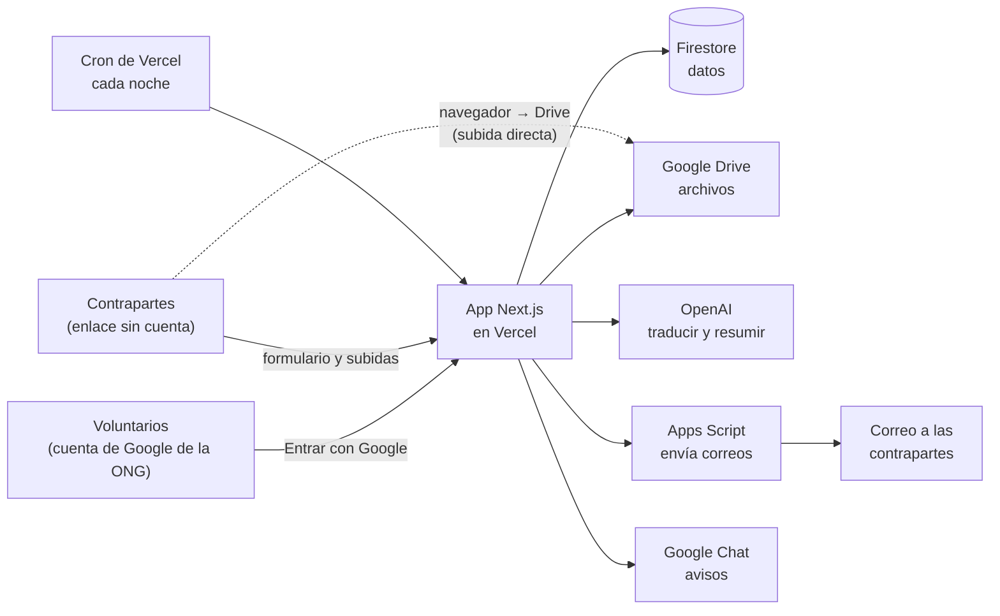
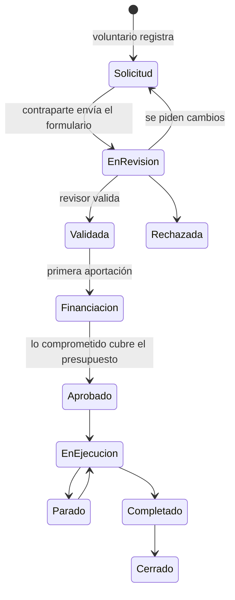
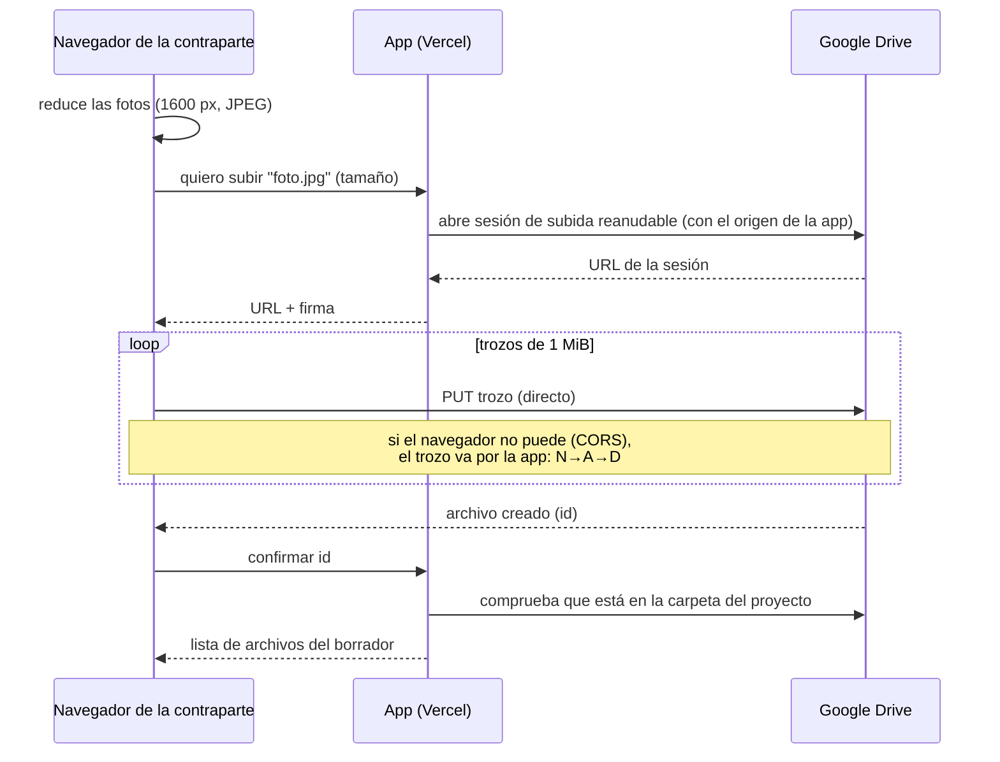

# Cómo funciona el sistema

## En una frase

Una aplicación web propia (Next.js en Vercel) organiza el trabajo y guarda los datos en Firestore. Google Drive guarda los archivos, Apps Script y Google Chat envían los avisos, y la IA de OpenAI traduce, resume y, más adelante, redacta borradores. Los voluntarios solo deciden y revisan.

## Piezas



| Pieza | Qué hace | Coste | Límites que importan |
| --- | --- | --- | --- |
| **App Next.js** (Vercel Hobby) | Pantallas, API y todas las reglas. Es la única pieza con lógica propia, escrita en TypeScript | Gratis | 4,5 MB por petición, 300 s por función, cron una vez al día |
| **Firestore** (Firebase Spark) | Base de datos, en Europa. Solo la usa el servidor | Gratis | 50.000 lecturas y 20.000 escrituras al día |
| **Firebase Auth** | Entrar con Google; solo cuentas `@africadirecto.org` | Gratis | — |
| **Google Drive** (unidades compartidas) | Archivos de cada proyecto, plantillas y copias | Gratis (100 TB) | — |
| **Apps Script** | Envía correos desde un buzón de Workspace. En la fase 2, leerá el buzón | Gratis | 1.500 destinatarios al día, 6 min por ejecución |
| **Google Chat** (webhook) | Avisos a los voluntarios | Gratis | — |
| **OpenAI** (API de Responses) | Traducir, resumir, señalar lo que falta; en la fase 3, redactar | ~1 $/mes | El límite de gasto que se ponga |

El servidor casero de la ONG **no forma parte del sistema**; como mucho, puede descargar una segunda copia de las copias nocturnas.

## El recorrido de un proyecto



*Cancelado es posible desde cualquier estado no final. Cada cambio guarda quién, cuándo y por qué en la cronología.*

Qué ocurre por dentro en cada paso:

1. **Nueva solicitud** (voluntario con permiso de edición):
   - Se crea la contraparte, si es nueva, y el proyecto con un código `P-AAAA-NNN` de un contador anual.
   - Se crea su carpeta en Drive con las 7 subcarpetas y un enlace firmado para la contraparte.
   - Si el correo está configurado, se le envía el formulario en su idioma.
2. **Formulario de la contraparte** (`/f/<token>`):
   - Se guarda a cada cambio en el móvil y, a los 2,5 s, en el servidor (borrador).
   - Las fotos se reducen en el navegador antes de subir. Los archivos van a Drive en trozos de 1 MiB, y si se corta la conexión se reanuda donde se quedó (detalle más abajo).
3. **Envío:**
   - Se guarda la versión `vN`, se copian los datos a la ficha y el proyecto pasa a «En revisión».
   - Al terminar la respuesta, y sin hacer esperar a la contraparte, la IA traduce, resume y señala lo que falta, se genera el PDF en `01_Solicitud` y se avisa en Chat.
4. **Revisión:** validar, pedir cambios o rechazar.
   - Al pedir cambios, el comentario se traduce al idioma de la contraparte, el mismo enlace se reabre (y se alarga su caducidad) y se le envía el correo.
5. **Financiación:**
   - Cada aportación tiene donante, importe y estado: ofrecida → interesado → comprometida → recibida, o descartada.
   - Al cambiar una, se recalcula lo comprometido. La primera pasa el proyecto a «Financiación», y cuando lo comprometido cubre el presupuesto pasa solo a «Aprobado».
6. **Ejecución y seguimiento:** notas, cambios de estado y, en la fase 2, correos y fotos que llegan.
   - La app avisa de los proyectos sin noticias en más de 30 días.
7. **Informes** (fase 3): borradores de IA en Google Docs que un voluntario revisa y aprueba. Ver [Plantillas e informes con IA](#plantillas-e-informes-con-ia).

## Datos

Firestore guarda documentos JSON en colecciones. Las fechas se guardan como texto ISO.

| Colección | Qué guarda |
| --- | --- |
| `proyectos/{código}` | Ficha del proyecto: estado, ubicación, presupuesto y totales, carpeta de Drive, contraparte (copia), responsable, estado del formulario y fechas |
| └ `solicitudes/borrador`, `solicitudes/v1…` | El borrador del formulario y cada versión enviada, con el análisis de la IA |
| └ `revisiones/…` | Decisiones del revisor |
| └ `eventos/…` | La cronología: estados, notas, solicitud, aportaciones (y correos en la fase 2) |
| └ `archivos/{idDrive}` | Archivos conocidos y si una foto es publicable |
| `contrapartes/…` | Organización, país, contacto, correos e idioma |
| `donantes/…` | Datos, informes que pide y enlace a su plantilla |
| `aportaciones/…` | Relación proyecto–donante con importe, moneda y estado |
| `enlaces/{id}` | Accesos de las contrapartes: proyecto, caducidad y si está revocado (sin el token) |
| `usuarios/{correo}` | Voluntarios, su permiso y su estado (pendiente, activo o rechazado) |
| `indices/proyectos` | **Índice del panel:** una fila por proyecto en un único documento |
| `contadores/proyectos-AAAA` | Último número de proyecto del año |
| `ajustes/drive`, `ajustes/ia` | Carpetas de año y de copias, y uso mensual de la IA |

**El índice del panel.** El inicio, el mapa, los avisos y el contador de solicitudes salen de un solo documento: una lectura por visita en vez de una por proyecto. Así no se agota la cuota gratuita de 50.000 lecturas al día. Se actualiza con cada cambio de proyecto y se reconstruye cada noche por si se desincroniza.

## Seguridad

- **Entrar:**
  - Firebase comprueba la cuenta de Google y el servidor exige el dominio `africadirecto.org` y el correo verificado.
  - La sesión es una cookie `httpOnly` de 14 días.
  - Quien entra por primera vez queda **pendiente** hasta que un administrador le da acceso. Se puede quitar el acceso en cualquier momento, con efecto inmediato.
- **Permisos:** lectura, edición y administración. Lo que no se puede hacer se oculta en la pantalla, pero **se comprueba siempre en el servidor**, en cada página y en cada acción.
- **Base de datos:** las reglas de Firestore niegan todo acceso desde el navegador. Solo el servidor entra, con la cuenta de servicio.
- **Enlaces de las contrapartes:**
  - El token es `id.firma`: un HMAC del id con `ENLACES_SECRETO`.
  - En la base de datos solo está el id, con su caducidad (180 días) y si está revocado.
  - Se comprueba en tiempo constante, se puede renovar (el anterior deja de valer) y tiene límite de peticiones por IP y por enlace.
- **Subidas:**
  - Solo se admiten tipos de archivo conocidos, de hasta 50 MB, y como máximo 40 archivos por solicitud.
  - Las sesiones de subida van firmadas, para que nadie use la app para subir a otro sitio.
- **Secretos:** solo en variables de entorno (Vercel y `.env.local`), nunca en el repositorio.
- **IA:**
  - Se envían solo datos del proyecto, sin nombres ni datos de contacto.
  - Se usa `store: false` para que OpenAI no conserve las respuestas en su plataforma.
- **RGPD:**
  - La ONG es la responsable del tratamiento. Google, Vercel y OpenAI son encargados.
  - Firestore está en Europa y las funciones de Vercel también (Fráncfort).
  - Solo las fotos marcadas como publicables pueden salir en informes.

## Subida de archivos desde el formulario



Si se corta la conexión, el navegador espera a que vuelva, pregunta a Drive cuánto tiene ya y sigue desde ahí. Ningún trozo pasa de 4 MiB, por debajo del límite de 4,5 MB de Vercel.

## Código

```
Pantallas (src/app)          → lo que ve el usuario; sin reglas de negocio
Acciones (src/lib/acciones)  → comprueban permisos y validan lo que llega
Dominio (src/lib/dominio)    → las reglas: estados, financiación, solicitudes…
Capas propias                → almacén (Firestore o fichero), Drive (API o disco), IA (OpenAI o sin IA)
```

- **Modo demo** (`MODO_DEMO=1`): las capas propias usan un fichero JSON y carpetas en disco, y se entra eligiendo un usuario. Sirve para probar y enseñar la app sin ninguna cuenta.
- **Cambiar de proveedor:** se añade otra implementación en `lib/almacen`, `lib/drive` o `lib/ia` y el resto no cambia.
- **Pruebas:** `npm test` cubre las reglas sin dependencias externas (estados, financiación, formulario, avisos y enlaces).

## Plantillas e informes con IA

> **Fase 3: todavía no está programado.** Este es el diseño previsto, para validarlo con el equipo antes de construirlo.

### Idea

Una plantilla es un **Google Doc (o Slides) normal** con **marcadores** entre llaves dobles. Para generar un informe, la app **copia la plantilla** en la carpeta `05_Informes` del proyecto y **sustituye los marcadores**: unos con datos de la app, otros con texto que redacta la IA. El resultado es un Google Doc corriente que un voluntario corrige a mano antes de aprobarlo.

### Marcadores

| Marcador | Qué pone | Ejemplo de resultado |
| --- | --- | --- |
| `{{proyecto.titulo}}`, `{{proyecto.codigo}}`, `{{proyecto.lugar}}`, `{{proyecto.pais}}` | Datos de la ficha | Aula escuela primaria · P-2026-014 · Kinshasa · RD Congo |
| `{{proyecto.presupuesto}}`, `{{proyecto.comprometido}}`, `{{proyecto.inicio}}` | Cifras y fechas con formato | 18.000 € · 3 ago 2026 |
| `{{contraparte.nombre}}` | Nombre de la contraparte | Sœurs de la Charité de Kinshasa |
| `{{donante.nombre}}`, `{{aportacion.importe}}` | El donante para el que es el informe | Fundación Horizonte · 12.000 € |
| `{{periodo.desde}}`, `{{periodo.hasta}}`, `{{hoy}}` | El periodo que cubre | 1 ago 2026 – 31 oct 2026 |
| `{{tabla:presupuesto}}`, `{{tabla:aportaciones}}` | Una tabla con los datos | Concepto / Importe… |
| `{{fotos:4}}` | Hasta 4 fotos **publicables** del periodo | (fotos) |
| `{{ia:avance\|150 palabras\|Describe el avance de las obras en el periodo}}` | Texto redactado por la IA: nombre, extensión e instrucción | "Durante agosto se terminaron los cimientos…" |

### Cómo se genera un informe

1. En la pestaña **Informes** de la ficha, el voluntario elige tipo (seguimiento, final, presentación, ficha), donante y periodo, y pulsa **Generar borrador**.
2. La app elige la plantilla: la **del donante**, si tiene una preparada, o la **de la ONG**.
3. **Copia** la plantilla en `05_Informes` con un nombre como `2026-11-10 Informe intermedio – Fundación Horizonte`.
4. Sustituye directamente los **marcadores de datos**.
5. Para cada **marcador de IA** hace una llamada al modelo de redacción. Va una por marcador para no pasar de los 300 s por función de Vercel.
   - **Contexto:** la ficha, los eventos del periodo con sus resúmenes, las aportaciones, la lista de fotos publicables y el informe anterior. Nada de datos de contacto.
   - **La IA devuelve** el texto, de qué eventos sale cada párrafo y lo que no ha encontrado.
   - **Lo que no consta se escribe `[PENDIENTE: …]`** en vez de inventarlo.
6. Las **fotos** se insertan desde Drive con un enlace temporal y firmado de la app. Google Docs necesita poder descargar la imagen, y así nunca se hacen públicas.
7. Al final del documento se añade un **anexo "Fuentes"** que dice de qué evento sale cada párrafo. El voluntario lo usa para comprobar y lo borra antes de enviar.
8. El informe pasa por estos estados en la app: **Borrador de IA → Revisado → Aprobado → Enviado**. El voluntario lo corrige en Google Docs, lo aprueba en la app y lo **exporta a PDF o Word**. La exportación se guarda en `05_Informes`.
9. **Nada sale hacia un donante sin aprobación humana.** La app ni siquiera lo envía: lo envía el voluntario.

### Plantillas propias de un donante (Word o Excel)

Muchos donantes mandan su propia plantilla, normalmente en Word. El proceso es:

1. **Subirla** desde la ficha del donante en la app, o dejarla en `AD · Plantillas/Donantes/<donante>/`. Se guarda el original sin tocar.
2. La app la **convierte** a Google Docs (o Sheets si es un Excel).
3. **La IA propone el mapeo una sola vez:** para cada apartado, pregunta o celda de la plantilla, sugiere qué va ahí. Puede ser un dato (`{{proyecto.presupuesto}}`), una instrucción para la IA ("resumen de actividades del periodo, 200 palabras") o "lo rellena una persona".
4. Un voluntario **revisa el mapeo** en una tabla de la app (apartado → qué va), lo ajusta y lo **valida**. La app escribe los marcadores en la copia convertida y guarda el mapeo en la colección `plantillas`: donante, tipo, archivo, mapeo, quién lo validó y cuándo.
5. A partir de ahí, los informes para ese donante salen ya con **su formato**. Al final se exportan a Word si el donante lo pide en ese formato. Conviene revisar que el formato se mantiene: la conversión Word ↔ Google Docs puede mover algún estilo.
6. **Plantillas de Excel** (justificación económica): mismo proceso, mapeando celdas a datos de aportaciones y gastos. Dependen de que la ONG decida si lleva el control económico en la app (pregunta abierta).

### Presentaciones para donantes

Igual, con una plantilla de **Google Slides**: los marcadores van en cuadros de texto, y las fotos sustituyen a formas marcadas como `{{foto}}`.

### Coste

Un informe de unas 8 secciones redactadas cuesta del orden de céntimos con un modelo intermedio. El presupuesto de 1 $ al mes da para decenas de informes además de las traducciones.

## Qué falta (siguientes fases)

| Fase | Qué incluye |
| --- | --- |
| **2. Seguimiento** | "Añadir correo" en la ficha (`.eml`, `.msg` o texto con adjuntos), lectura automática del buzón de la app según [CORREO.md](CORREO.md), bandeja de correos sin asignar, carpetas por mes en `04_Seguimiento` y página de subida de fotos para la contraparte |
| **3. Documentos con IA** | Plantillas, informes, presentación de captación y mapeo de plantillas de donante (diseño de arriba) |
| **4. Mejoras** | Ficha de solo lectura para donantes, estadísticas, formulario instalable sin conexión y WhatsApp si compensa |

## Fuentes

- [Google Docs API: insertar imágenes (la imagen tiene que poder descargarse)](https://developers.google.com/workspace/docs/api/how-tos/images)
- [Vercel – límites](https://vercel.com/docs/limits)
